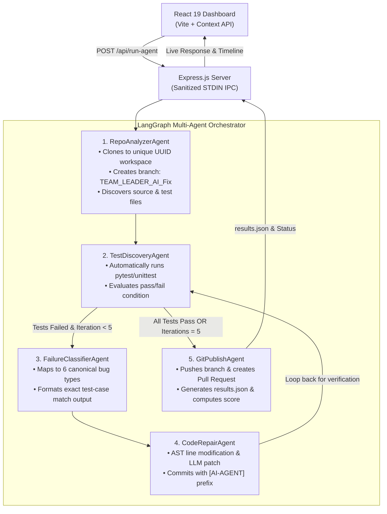

# Autonomous CI/CD Healing Agent

> **RIFT 2026 HACKATHON • AIML & DevOps Automation Track**  
> An autonomous multi-agent system powered by **LangGraph** with a reactive React dashboard that detects, analyzes, heals, and verifies CI/CD pipeline failures autonomously.

---

## 🔗 Submission Links

* **Live Deployment URL:** `https://rift-ci-cd-production.up.railway.app` *(or your Vercel frontend URL)*
* **LinkedIn Video Demonstration:** `https://www.linkedin.com/posts/your-handle-rift2026-demo` *(Tagged @RIFT2026)*
* **GitHub Repository:** [https://github.com/Sabir9-8/Rift-CI-CD](https://github.com/Sabir9-8/Rift-CI-CD)

---

## 🏗️ Multi-Agent Architecture

The agent is built on a cyclic **LangGraph StateGraph** that continuously runs, detects, heals, and verifies code until all test suites pass or the iteration limit (default: 5) is reached.



---

## 🐞 Supported Bug Types

The agent classifies and heals issues across the **6 canonical bug categories** specified in the challenge:

| Bug Type | Description | Targeted Healing Strategy |
|---|---|---|
| **`LINTING`** | Unused imports (F401), unused variables, style violations | AST-level line deletion or identifier cleanup |
| **`SYNTAX`** | Missing colons (`:`), unmatched brackets, malformed statements | AST statement analysis and automatic colon/token insertion |
| **`LOGIC`** | ZeroDivisionError, off-by-one errors, bare exceptions | Exception handling guards and LLM-assisted algorithmic repairs |
| **`TYPE_ERROR`** | Incompatible operands (str + int), invalid argument types | Automatic type conversions (`str()`, `int()`) and casting |
| **`IMPORT`** | Missing dependencies, invalid module paths | Package discovery, dependency installation, and path fixes |
| **`INDENTATION`** | Tab/space mismatches, unexpected indentation blocks | Lexical token normalization to standard 4-space indentation |

### Exact Test Case Output Matching
The agent strictly generates judge-verifiable output strings:
* `LINTING error in src/utils.py line 15 → Fix: remove the import statement`
* `SYNTAX error in src/validator.py line 8 → Fix: add the colon at the correct position`

---

## 🛠️ Tech Stack

* **Frontend:** React 19, Vite, Framer Motion, Lucide Icons, Context API
* **Backend API:** Node.js, Express.js (Sanitized process streaming)
* **Agent Core:** Python 3.11, LangGraph, LangChain Core
* **AI & LLM Providers:** Google Gemini 1.5/2.0 Flash (Free tier native support), OpenAI GPT-4o-mini
* **Testing & Analysis:** Pytest, Flake8, Ruff, AST, Tokenize
* **Git & VCS Automation:** PyGithub, GitHub CLI (`gh`), Git

---

## 🚀 Installation & Local Setup

### Prerequisites
* **Node.js:** 18+
* **Python:** 3.10+
* **Git:** Installed and available in PATH

### 1. Clone & Install Dependencies
```bash
git clone https://github.com/Sabir9-8/Rift-CI-CD.git
cd Rift-CI-CD

# Python environment
pip install -r requirements.txt

# Frontend dependencies
cd frontend
npm install

# Backend dependencies
cd ../backend
npm install
cd ..
```

### 2. Environment Configuration
Create a `.env` file in the `backend/` directory:
```env
PORT=3002
NODE_ENV=development

# Optional: GitHub token with 'repo' scope (otherwise relies on gh CLI)
GITHUB_TOKEN=ghp_your_token_here

# Optional: AI Provider (Gemini is 100% free via Google AI Studio)
GEMINI_API_KEY=your_gemini_api_key_here
OPENAI_API_KEY=your_openai_api_key_here
```

### 3. Run Locally
**Option 1: Single command**
```bash
./start.sh
```

**Option 2: Separate terminals**
```bash
# Terminal 1 - Backend
cd backend && node server.js

# Terminal 2 - Frontend
cd frontend && npm run dev
```
Open [http://localhost:5173](http://localhost:5173) in your browser.

---

## 📖 Usage Examples

1. **Open the Dashboard:** Navigate to [http://localhost:5173](http://localhost:5173).
2. **Enter Repository Details:**
   * **Repository URL:** `https://github.com/owner/repository`
   * **Team Name:** `RIFT ORGANISERS`
   * **Leader Name:** `Saiyam Kumar`
   * *(Optional)* Provide GitHub Token or Gemini/OpenAI key.
3. **Click "Run Agent":**
   * The agent automatically clones the repo.
   * Creates the required branch: `RIFT_ORGANISERS_SAIYAM_KUMAR_AI_Fix`.
   * Automatically discovers and runs test files.
   * Iterates through code repairs until all tests pass.
   * Commits fixes using `[AI-AGENT]` prefix and pushes to origin.
   * Writes the official `results.json` artifact at the project root.

---

## 📊 Score Calculation Logic

The score is computed strictly according to the RIFT 2026 rubric:
$$\text{Final Score} = \max\left(0, \text{Base (100)} + \text{Speed Bonus} - \text{Efficiency Penalty}\right)$$

* **Base Score:** 100 points
* **Speed Bonus:** $+10$ points if execution finishes in $< 5$ minutes ($< 300\text{s}$) and CI/CD passes.
* **Efficiency Penalty:** $-2$ points per commit over 20 commits.
* **Max Possible Score:** 110 points.

---

## ⚠️ Known Limitations

1. **Language Scope:** Currently optimized for Python codebases (`pytest`, `unittest`, AST analysis).
2. **Private Network Isolated Repositories:** Requires self-hosted runners if target repositories are behind enterprise firewalls/VPNs.
3. **Binary/Compiled Dependencies:** C-extension compile errors requiring system-level packages (`apt-get`) require appropriate container base images.

---

## 👥 Team Members

* **Team Name:** RIFT CI/CD Healers
* **Team Leader:** Sabir
* **Track:** AI/ML • DevOps Automation • Agentic Systems Track
